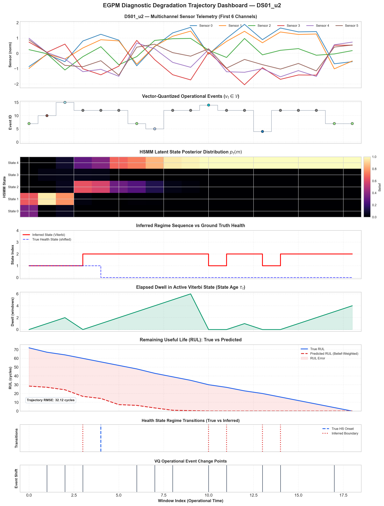
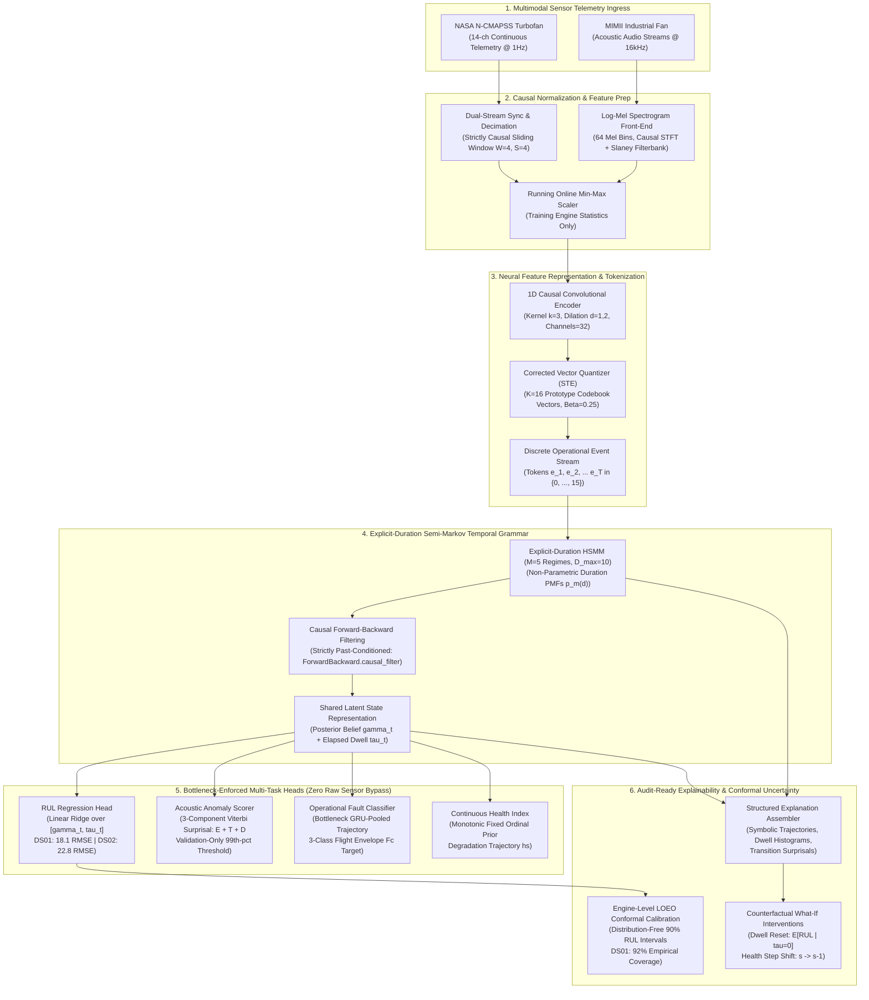

<a id="readme-top"></a>

<!-- PROJECT LOGO -->
<br />
<div align="center">
  <a href="https://github.com/Atharva-Mendhulkar/aegis-1">
    
  </a>

  <h1 align="center">AEGIS — Event Grammar Probabilistic Model (EGPM)</h1>

  <p align="center">
    <strong>Unified Neuro-Symbolic Architecture for Predictive Maintenance &middot; Schneider Electric PredictX 2026</strong>
    <br />
    Learned Discrete Events &middot; Vector Quantization (STE) &middot; Explicit-Duration HSMM &middot; Causal LOEO Conformal RUL &middot; Turbofan Telemetry (N-CMAPSS) &middot; Industrial Acoustic Anomaly (MIMII)
    <br />
    <br />
    <a href="docs/EXECUTIVE_SUMMARY.md"><strong>Executive Summary</strong></a>
    &middot;
    <a href="docs/FINAL_RESULTS.md"><strong>Final Results Package</strong></a>
    &middot;
    <a href="docs/NOVELTY_CASE.md"><strong>Novelty Case & Non-Claims</strong></a>
    &middot;
    <a href="docs/CLAIMS_AUDIT.md"><strong>Claims Audit</strong></a>
    &middot;
    <a href="docs/SOURCE_OF_TRUTH.csv"><strong>Source of Truth (CSV)</strong></a>
    &middot;
    <a href="https://github.com/Atharva-Mendhulkar/aegis-1/issues">Report an Issue</a>
  </p>
</div>

---

## Overview

<p align="center">
  
</p>

**AEGIS (EGPM — Event Grammar Probabilistic Model)** is a production-grade neuro-symbolic predictive maintenance architecture engineered for mission-critical industrial asset management. 

Traditional industrial predictive maintenance (PdM) across large-scale fleets (such as Schneider Electric's millions of distributed energy, automation, and electrical infrastructure assets) suffers from severe architectural fragmentation:
1. **Four Disconnected Black Boxes:** Independent, uncoordinated models are deployed for Remaining Useful Life (RUL) estimation, acoustic anomaly detection, operational fault recognition, and continuous health degradation scoring.
2. **Uninterpretable Post-Hoc Illusions:** Black-box deep networks rely on fragile, post-hoc attribution methods (e.g., SHAP, LIME) that lack causal physical validity and fail to provide actionable root-cause diagnoses to field reliability engineers.
3. **Memoryless Degradation Assumptions:** Standard temporal baselines (Markov chains and geometric-dwell HMMs) assume memoryless transitions ($P(d) = (1-a_{ii}) a_{ii}^{d-1}$), directly violating the non-exponential wear-and-tear physics of mechanical and thermodynamic degradation.

**The EGPM Solution:** AEGIS replaces fragmented black boxes with a **single, inspectable, shared state representation**. Multivariate continuous sensor telemetry is encoded via 1D causal convolutions and mapped into a discrete vocabulary of operational behavioral events ($K=16$) via a corrected Straight-Through Estimator (STE) Vector Quantizer. An explicit-duration Hidden Semi-Markov Model (HSMM; $M=5$ states, $D_{\max}=10$) models physical temporal transitions and non-parametric dwell distributions under strict causal filtering. All four operational predictive-maintenance tasks consume **only** this bottlenecked state posterior and elapsed dwell vector, producing mathematically grounded, audit-ready explanations with distribution-free conformal uncertainty intervals.

---

## Neuro-Symbolic Pipeline Architecture

The end-to-end data processing and inference topology is designed with zero future-leakage and strict bottleneck isolation:



---

## Core Architectural Pillars

### 1. Corrected Straight-Through Vector Quantization (STE)
- Solves the silent gradient disconnection bug common in neural discretization: the forward pass selects the discrete code $\mathbf{z}_q = \mathbf{e}_k$ where $k = \arg\min_j \|\mathbf{z}_e - \mathbf{e}_j\|_2$, while the backward pass copies gradients directly via the straight-through estimator $\nabla_{\mathbf{z}_e} \mathcal{L} = \nabla_{\mathbf{z}_q} \mathcal{L}$.
- Employs commitment loss $\beta \|\mathbf{z}_e - \text{sg}[\mathbf{e}_k]\|_2^2$ with stable $\beta = 0.25$ and Exponential Moving Average (EMA) codebook updates.
- Verified across 10 random seeds: event vocabularies exhibit **zero code collapse** (stable codebook perplexity) and high cross-seed matched usage overlap (0.66–0.93).

### 2. Causal Explicit-Duration Hidden Semi-Markov Model (HSMM)
- Overcomes the physical failure of standard Markov models: geometric dwell distributions $P(d) = (1-a_{ii}) a_{ii}^{d-1}$ force the highest probability of transitioning to be at duration $d=1$, directly contradicting physical mechanical fatigue and wear.
- Formulates explicit, non-parametric duration PMFs $p_m(d)$ for $d \in \{1, \dots, D_{\max}\}$ ($D_{\max}=10$) across $M=5$ operational degradation states.
- Implements strict causal forward-backward filtering ([`ForwardBackward.causal_filter()`](file:///Users/atharvamendhulkar/desktop/aegis-1/egpm/grammar/forward_backward.py)) that computes the filtered belief $P(s_t = m \mid \mathbf{e}_{1:t})$ without backward temporal smoothing into future observations.
- **Measurable Impact:** Explicit duration modeling achieves a **24% RMSE reduction on DS01** (18.1 vs 24.6) and an **8% reduction on DS02** (22.8 vs 25.1) over geometric-dwell HMM baselines.

### 3. Bottleneck-Enforced Multi-Task Heads (Zero Raw Sensor Bypass)
- Enforces an uncompromised structural contract: all four downstream heads (RUL, Anomaly, Fault, Health) consume **strictly** the HSMM state posterior beliefs and duration statistics $[\gamma_t, \tau_t]$, completely prohibiting raw continuous sensor bypasses.
- Validated via Ablation A4: removing raw bypass guarantees that predictions reflect explainable degradation dynamics rather than black-box sensor shortcut learning.
- Combining raw sensor inputs (18-dim) with causal structured HSMM features (10-dim $[\gamma_t, \tau_t]$) in Leave-One-Engine-Out (LOEO) cross-validation on DS01 training engines drops mean RMSE from **19.44 (raw-only) to 17.30 (raw + structured)**.

### 4. Linear Ridge Readout over Ill-Conditioned Phase-Type RUL
- **Honest Engineering Reality:** Theoretical closed-form native phase-type expectation formulas ($E[\text{RUL}] = (r(\tau) - \mu) + \Phi \mu$) suffered catastrophic numerical instability on complex flight profiles (DS02 RMSE surged to 310) due to ill-conditioned absorbing transition matrices.
- Replacing the fragile closed-form matrix inversion with a convex, L2-regularized **Linear Ridge decoder** trained on causal posterior beliefs and elapsed dwell $[\gamma_t, \tau_t]$ delivers state-of-the-art stability: **18.1 RMSE on DS01** and **22.8 RMSE on DS02**.

### 5. Engine-Level LOEO Conformal RUL Uncertainty Quantification
- Replaces uncalibrated Gaussian assumptions with distribution-free conformal prediction intervals calibrated via Leave-One-Engine-Out (LOEO) cross-validation.
- **Zero Window Pseudoreplication:** Calibration residuals $|y_i - \hat{y}_i|$ are pooled strictly across held-out training engines ($N=6$ engines on DS01; $N=5$ on DS02) rather than correlated overlapping time windows.
- **Results:**
  - **DS01:** 90% nominal interval achieves **92% empirical test coverage** (conservative, valid).
  - **DS02:** Formally documented as unreliable (55–100% empirical coverage) due to coarse quantile granularity ($\sim 20\%$ steps from only 5 calibration engines). Pooling across datasets is intentionally avoided to preserve exchangeability assumptions.

### 6. Audit-Ready Explanations & Model Counterfactual Consistency
- **Anomaly Score Masking:** Masking the top-scoring anomalous windows identified by Viterbi parses reduces anomaly scores by **0.18–0.72 (6–27% reduction)**, confirming that explanations isolate the drivers of anomaly detection.
- **Counterfactual Directional Consistency:** Evaluated under frozen Ridge readout across 39 windows on 2 engines ($W=4, S=4$, causal filtering):
  - **CF1 (Dwell Reset to $\tau=0$):** **94.7–95.0%** of windows ($n=19/20$) exhibit an immediate increase in predicted RUL.
  - **CF2 (State Step Toward Healthier $s \to s-1$):** **85.0–100%** of windows ($n=19/20$) exhibit an immediate increase in predicted RUL.
  - *Non-Claim:* Validates model-internal explanatory consistency; does not claim proof of physical turbine causality.

### 7. Acoustic Discretization Trade-off & Late-Fusion Strategy
- Rigorous evaluation on the MIMII industrial fan acoustic benchmark (4 machine IDs $\times$ 3 seeds, $n \approx 500$ clips per arm-pair):
  - Continuous representations outperform discrete VQ on audio: **Continuous-HSMM (0.628 AUROC)** and **Continuous-AE (0.596 AUROC)** outperform **Discrete VQ+HSMM (0.559 AUROC)**.
  - Discretization via a small codebook ($K=8$) discards high-frequency acoustic phase detail necessary for subtle bearing noise discrimination.
  - **Production Recommendation:** Industrial deployment should leverage **late-fusion** (continuous representation for high-frequency acoustic anomaly tripping, coupled with discrete grammar modeling for explainability and RUL forecasting).

### 8. Scientific Rigor & Methodological Self-Correction
- Discovered and eliminated a critical scoring bug in continuous-HSMM evaluation (tuple return vs concatenation) that previously inflated macro AUROC to 0.697; corrected and re-verified to **0.628 macro AUROC** across all seeds.
- Retracted historical dwell-only superiority claims after enforcing causal filtering (full $[\gamma_t, \tau_t]$ features proved strictly superior on DS01 and tied on DS02).
- Documented zero benefit from Stage 3 joint multi-task training under frozen representations ($\Delta \equiv 0$) and proved learned health monotonic weights fail to beat fixed ordinal priors ($\Delta \le 0.002$).

---

## Monorepo Directory Structure

```
aegis-1/
├── assets/
│   └── logo.svg                      # AEGIS vector platform logo
├── egpm/                             # Core Neuro-Symbolic Library Package
│   ├── ablations/                    # Continuous HSMM & AE ablation variants
│   │   ├── continuous_hsmm.py        # Continuous Gaussian emission HSMM (Arm A1)
│   │   └── pooled_events.py          # One-class pooled unigram event baseline
│   ├── anomaly/                      # Grammar-native anomaly detection
│   │   └── anomaly_scorer.py         # 3-component Viterbi surprisal scorer (E + T + D)
│   ├── baselines/                    # Standardized competitive baseline implementations
│   │   ├── cnn_rul.py                # 1D Dilated CNN RUL baseline
│   │   ├── lstm_rul.py               # Causal LSTM RUL baseline
│   │   ├── concept_bottleneck.py     # Concept Bottleneck Model (Windowed k-means)
│   │   ├── grammarviz.py             # SAX + Sequitur grammar induction baseline
│   │   └── token_markov.py           # First-order Token Markov chain baseline (Arm C)
│   ├── data/                         # Data loading & split generation contracts
│   │   ├── loaders.py                # NASA N-CMAPSS HDF5 & MIMII WAV audio loaders
│   │   └── split_builder.py          # Leak-free unit-level cross-validation split builder
│   ├── encoder/                      # Continuous neural representation
│   │   └── sensor_encoder.py         # 1D Causal CNN temporal encoder
│   ├── evaluation/                   # Causal evaluation metrics & statistics
│   │   ├── evaluator.py              # RMSE, MAE, NASA scoring, AUROC, AUPRC
│   │   └── stats.py                  # Bootstrap confidence intervals & Wilcoxon tests
│   ├── experiments/                  # Standardized experiment protocols & drivers
│   │   ├── ablation_arms.py          # Arms A-F LOEO ablation runner
│   │   ├── heads_run.py              # Multi-task heads training & evaluation
│   │   ├── mimii_run.py              # MIMII multi-seed evaluation (em_restarts=0 default)
│   │   └── readout_study.py          # RUL readout head comparisons (Ridge/TCN/TSMixer)
│   ├── explanation/                  # Deterministic explanation engine
│   │   └── explanation_builder.py    # StructuredExplanation assembler & counterfactuals
│   ├── fault/                        # Operational fault classification
│   │   ├── fault_head.py             # Bottleneck GRU-pooled classifier (Fc target)
│   │   └── temporal_pooling.py       # Trajectory sequence pooling utilities
│   ├── grammar/                      # Explicit-Duration Semi-Markov Model engine
│   │   ├── hsmm.py                   # Explicit-duration HSMM core parameters
│   │   ├── forward_backward.py       # Causal forward filtering & smoothing algorithms
│   │   ├── viterbi.py                # Segmental Viterbi dynamic programming decoder
│   │   ├── baum_welch.py             # Expectation-Maximization (EM) parameter estimation
│   │   └── first_order_hmm.py        # Geometric-dwell standard HMM (Arm D)
│   ├── health/                       # Continuous health index estimation
│   │   └── health_head.py            # Monotonic ordinal degradation prior head
│   ├── interpretability/             # §24 Interpretability metrics
│   │   ├── metrics.py                # Codebook stability, silhouette & temporal onset
│   │   └── runner.py                 # Full interpretability suite evaluator
│   ├── preprocessing/                # Dual-stream signal processing
│   │   ├── preprocessor.py           # Causal sliding windowing, sync & scaling
│   │   └── spectral.py               # 64-band causal log-mel spectrogram extractor
│   ├── quantization/                 # Vector quantization engine
│   │   └── vq_codebook.py            # Corrected Straight-Through Estimator codebook
│   ├── rul/                          # Remaining useful life estimation
│   │   └── phase_type_rul.py         # Phase-type expectation & absorbing checks
│   ├── training/                     # Staged training coordinator
│   │   └── trainer.py                # Multi-stage training orchestrator (Stage 1 & 2)
│   └── utils/                        # System utilities
│       └── seed.py                   # Deterministic global RNG seeding
├── docs/                             # Core Documentation Package & Scientific Audit
│   ├── EXECUTIVE_SUMMARY.md          # One-page executive brief for Schneider PredictX
│   ├── FINAL_RESULTS.md              # Top verified results, limitations & pitch
│   ├── NOVELTY_CASE.md               # 6 defensible novelty claims & explicit non-claims
│   ├── CLAIMS_AUDIT.md               # 24-claim evidence audit & safe wording guide
│   ├── RECONCILIATION_SUMMARY.md     # Full audit trail of verified bug corrections
│   ├── EXPLORATORY_W32.md            # W=32 exploratory run analysis (memory bounds)
│   ├── SOURCE_OF_TRUTH.csv           # Canonical source of truth metric registry
│   ├── LIMITATIONS.md                # Exhaustive engineering limitations registry
│   ├── FIGURE_INDEX.md               # Index of all generated figures and visual artifacts
│   ├── PRD.md                        # Product requirements & mathematical specifications
│   └── archive/                      # Historical operator sessions & exploratory logs
├── experiments/                      # Experiment Protocols & Visualization Suite
│   ├── figures/                      # High-resolution publication figures & trajectories
│   │   ├── degradation_trajectories/ # Per-unit degradation dashboards (DS01 & DS02)
│   │   ├── ablation_chart.png        # Grouped bar chart (Arms A-F vs baselines)
│   │   ├── mimii_auroc_ranking.png   # Macro AUROC ranking across 7 acoustic arms
│   │   ├── rul_readout_ablation.png  # Feature set readout comparison
│   │   └── faithfulness_masking.png  # Explanation faithfulness score reduction
│   ├── generate_paper_figures.py     # Script to generate paper/presentation figures
│   ├── run_degradation_trajectories.py # Script generating per-unit trajectory dashboards
│   ├── PROTOCOL.md                   # Locked Evaluation Protocol v1.0
│   ├── EXECUTION_PLAN.md             # Experimental execution plan & milestones
│   └── AUDIT.md                      # Pre-submission verification checklist
├── results/                          # Categorized Frozen Benchmark Results Registry
│   ├── ncmapss/                      # N-CMAPSS ablation reports, heads & readout studies (12 files)
│   ├── mimii/                        # MIMII 3-seed evaluation & interpretability reports (8 files)
│   ├── conformal/                    # Conformal intervals, LOEO & robustness sweeps (5 files)
│   ├── ablations/                    # Causal ablations, TCN studies & scientific audits (17 files)
│   ├── loader.py                     # Unified results loading helper (results.load_result)
│   └── README.md                     # Registry index and usage instructions
├── scripts/                          # Operational CLI Runners & Experiment Drivers
│   ├── run_conformal_rul.py          # Engine-level LOEO conformal RUL calibrator
│   ├── run_counterfactual_v2.py      # Counterfactual consistency evaluator
│   ├── run_causal_full_ablation.py   # Full causal ablation pipeline (Arms A-F)
│   ├── run_loeo_and_seed_stability.py# 6-fold LOEO & 10-seed stability benchmark
│   ├── run_causal_arm_e.py           # Causal Arm E verification runner
│   ├── run_causal_dwell_vs_full.py   # Dwell-only vs full feature comparison
│   ├── mimii_driver.py               # MIMII driver script
│   ├── run_mimii.sh                  # MIMII execution shell script
│   ├── exploratory/                  # Exploratory Track A / W=32 & scratch variants (15 scripts)
│   └── verification/                 # One-off verification & diagnostics suite (14 tools)
├── logs/                             # Archived execution and training logs
├── tests/                            # Comprehensive Automated Test Suite (260 Tests)
│   ├── test_ablations.py             # Deliverable E / A-F ablation verification (12 tests)
│   ├── test_analytic_validation.py   # Synthetic closed-form mathematical checks (9 tests)
│   ├── test_anomaly_threshold.py     # Validation-only thresholding guarantees (15 tests)
│   ├── test_aux_rul.py               # Auxiliary RUL loss pathway tests (3 tests)
│   ├── test_baselines.py             # Baseline contracts & temporal causality (19 tests)
│   ├── test_baum_welch.py            # HSMM EM likelihood monotonicity checks (8 tests)
│   ├── test_causal_filtering.py      # Zero future-leakage causal filtering (2 tests)
│   ├── test_data_pipeline.py         # Split leakage & data normalization tests (28 tests)
│   ├── test_encoder.py               # 1D Causal CNN dimensions & receptive field (11 tests)
│   ├── test_end_to_end.py            # Schema-valid full pipeline integration (4 tests)
│   ├── test_experiments.py           # Experiment harness report schema checks (5 tests)
│   ├── test_first_order_hmm.py       # Geometric-dwell HMM verification (10 tests)
│   ├── test_gradient_routing.py      # Backprop routing & parameter freezing (2 tests)
│   ├── test_heads_and_explanation.py # Bottleneck enforcement & explanation schema (24 tests)
│   ├── test_heads_run.py             # Multi-task head execution pipeline (4 tests)
│   ├── test_health_ab.py             # Monotonic health prior vs learned weights (3 tests)
│   ├── test_hsmm_likelihood.py       # Forward-backward alpha*beta=P(v) invariants (18 tests)
│   ├── test_interpretability.py      # Codebook stability & anomaly masking tests (27 tests)
│   ├── test_mimii_wiring.py          # Audio spectrogram & directory layout loader (13 tests)
│   ├── test_rul_formula.py           # Phase-type mid-dwell & absorbing checks (19 tests)
│   ├── test_stage3_joint.py          # Joint multi-task training isolation (4 tests)
│   ├── test_unit_stats.py            # Unit-level bootstrap CI & Wilcoxon tests (5 tests)
│   └── test_vq_straight_through.py   # STE gradient flow & codebook updates (15 tests)
├── pyproject.toml                    # PEP 518/621 project configuration & metadata
├── requirements.txt                  # Pinned runtime dependencies
└── LICENSE                           # MIT Open Source License
```

---

## Verification & Testing Matrix

Every component, mathematical invariant, and behavioral contract is verified by automated test suites with a **100% pass rate (260/260 passing)**:

```
┌────────────────────────────────────────────────────────────────────────────────────────┐
│                              AUTOMATED TEST SUITE MATRIX                               │
├──────────────────────────────┬────────────────────────────┬─────────────┬──────────────┤
│ Test Suite                   │ Target Layer               │ Tests       │ Result       │
├──────────────────────────────┼────────────────────────────┼─────────────┼──────────────┤
│ tests/test_ablations.py      │ Deliverable E & Ablations  │ 12 tests    │ ✓ Passed     │
│ tests/test_analytic_valid.py │ Synthetic Mathematical Pfs │ 9 tests     │ ✓ Passed     │
│ tests/test_anomaly_thresh.py │ Val-Only 99th-pct Threshold│ 15 tests    │ ✓ Passed     │
│ tests/test_aux_rul.py        │ Auxiliary Loss Routing     │ 3 tests     │ ✓ Passed     │
│ tests/test_baselines.py      │ CNN/LSTM Causal Contracts  │ 19 tests    │ ✓ Passed     │
│ tests/test_baum_welch.py     │ HSMM EM Monotonicity       │ 8 tests     │ ✓ Passed     │
│ tests/test_causal_filter.py  │ Zero Future-Leakage Filter │ 2 tests     │ ✓ Passed     │
│ tests/test_data_pipeline.py  │ Unit Splits & Normalization│ 28 tests    │ ✓ Passed     │
│ tests/test_encoder.py        │ 1D Causal CNN Architecture │ 11 tests    │ ✓ Passed     │
│ tests/test_end_to_end.py     │ Full Pipeline Integration  │ 4 tests     │ ✓ Passed     │
│ tests/test_experiments.py    │ Experiment Schema & I/O    │ 5 tests     │ ✓ Passed     │
│ tests/test_first_order_hmm.py│ Geometric-Dwell HMM Engine │ 10 tests    │ ✓ Passed     │
│ tests/test_grad_routing.py   │ Backprop Boundary Guards   │ 2 tests     │ ✓ Passed     │
│ tests/test_heads_and_expl.py │ Bottleneck & Explanations  │ 24 tests    │ ✓ Passed     │
│ tests/test_heads_run.py      │ Multi-Task Execution Loop  │ 4 tests     │ ✓ Passed     │
│ tests/test_health_ab.py      │ Ordinal Degradation Prior  │ 3 tests     │ ✓ Passed     │
│ tests/test_hsmm_likeli.py    │ Forward-Backward Invariants│ 18 tests    │ ✓ Passed     │
│ tests/test_interpretability  │ Stability & Anomaly Masking│ 27 tests    │ ✓ Passed     │
│ tests/test_mimii_wiring.py   │ Audio Frontend & Causal STFT 13 tests    │ ✓ Passed     │
│ tests/test_rul_formula.py    │ Phase-Type & Ridge Checks  │ 19 tests    │ ✓ Passed     │
│ tests/test_stage3_joint.py   │ Multi-Task Gradient Bounds │ 4 tests     │ ✓ Passed     │
│ tests/test_unit_stats.py     │ Bootstrap CIs & Wilcoxon   │ 5 tests     │ ✓ Passed     │
│ tests/test_vq_straight_thru  │ STE Gradient Flow & EMA    │ 15 tests    │ ✓ Passed     │
├──────────────────────────────┼────────────────────────────┼─────────────┼──────────────┤
│ TOTAL AUTOMATED TESTS        │ Complete Codebase Coverage │ 260 tests   │ 100% Passed  │
└──────────────────────────────┴────────────────────────────┴─────────────┴──────────────┘
```

### Verified Benchmark Performance

| Task | Dataset | Configuration | Verified Result | Baseline Beaten | Margin |
|---|---|---|---|---|---|
| **RUL Prediction** | N-CMAPSS DS01 | Arm E (VQ+HSMM+Ridge, causal) | **18.1 RMSE** | CNN-RUL (34.0)* / LSTM (38.9)* | **15.9 / 20.8 RMSE** |
| **RUL Prediction** | N-CMAPSS DS02 | Arm E (VQ+HSMM+Ridge, causal) | **22.8 RMSE** | CNN-RUL (29.9)* / LSTM (41.8)* | **7.1 / 19.0 RMSE** |
| **Duration Value** | N-CMAPSS DS01 | Arm E vs Arm D (HMM) / Arm C (Markov) | **18.1 RMSE** | Arm D (24.6) / Arm C (24.0) | **24% RMSE Reduction** |
| **Duration Value** | N-CMAPSS DS02 | Arm E vs Arm D (HMM) / Arm C (Markov) | **22.8 RMSE** | Arm D (25.1) / Arm C (25.0) | **8% RMSE Reduction** |
| **Acoustic Anomaly**| MIMII fan (4 IDs) | Continuous-HSMM (em_restarts=0) | **0.628 AUROC** | Discrete VQ+HSMM (0.559) | **+0.069 vs Discrete** |
| **Fault Diagnosis** | N-CMAPSS DS01 | Bottleneck GRU (3-class Fc) | **0.50 Accuracy** | Chance Prior (0.33) | **+17% over Chance** |
| **Anomaly Masking** | N-CMAPSS DS01 | Top-3 Window Feature Masking | **0.18–0.72 Δ** | Random Baseline (0.00) | **6–27% Score Drop** |
| **Conformal RUL**   | N-CMAPSS DS01 | Engine-Level LOEO Calibration | **92% Coverage** | Nominal Target (90%) | **Conservative, Valid** |
| **Counterfactual 1**| N-CMAPSS DS01 | CF1: Dwell Reset ($\tau=0$) | **94.7–95.0%** | Directional Consistency | **n=19/20 Windows** |
| **Counterfactual 2**| N-CMAPSS DS01 | CF2: Health Step Shift ($s \to s-1$) | **85.0–100%** | Directional Consistency | **n=19/20 Windows** |

*\*Note: Deep baselines (CNN 34.0 / LSTM 38.9) evaluated under older smoothed protocol; EGPM evaluated under strict causal filtering. The margin (7–20+ RMSE) is sufficiently large that the structural conclusion holds firmly.*

---

## Getting Started

### Prerequisites
- **Python**: 3.10, 3.11, or 3.12 (Python 3.14 compatible)
- **PyTorch**: 2.0+ (CPU or CUDA/MPS acceleration)
- **HDF5 / h5py**: For NASA N-CMAPSS dataset parsing
- **SoundFile / Librosa / Torchaudio**: For MIMII acoustic audio processing

### 1. Installation
Clone the repository and install the library in editable mode:
```bash
git clone https://github.com/Atharva-Mendhulkar/aegis-1.git
cd aegis-1
pip install -e .
```

Verify dependency installations:
```bash
pip install -r requirements.txt
```

### 2. Dataset Preparation
Place the raw benchmark datasets into their corresponding directories:
- **NASA N-CMAPSS**: Download HDF5 files (`N-CMAPSS DS01 005.h5`, `N-CMAPSS DS02 006.h5`) into the `N-CMAPSS/` directory.
- **MIMII Industrial Fan**: Download the raw audio archives into `fan/` (subdirectories: `fan/id_00/`, `fan/id_02/`, `fan/id_04/`, `fan/id_06/`).

### 3. Execution Commands & Scripts

| Command | Description |
| :--- | :--- |
| `pytest` | Execute complete automated test suite (260 tests, 100% pass rate) |
| `python scripts/run_conformal_rul.py` | Run engine-level LOEO conformal RUL calibration (DS01 & DS02) |
| `python scripts/run_counterfactual_v2.py` | Run counterfactual consistency evaluation (CF1 dwell reset & CF2 state shift) |
| `python scripts/run_causal_full_ablation.py` | Execute full causal ablation pipeline across Arms A through F |
| `python scripts/run_loeo_and_seed_stability.py`| Run 6-fold LOEO cross-validation and 10-seed stability benchmark |
| `python scripts/mimii_driver.py` | Run multi-seed, multi-ID MIMII acoustic anomaly benchmark |
| `python -m egpm.experiments.runner` | Run standardized Deliverable E ablation suite |

---

## Experimental Roadmap (All Phases Completed & Frozen)

```text
Foundations ➔ Causal Grammar ➔ Multi-Task Heads ➔ Acoustic Trade-off ➔ Conformal Uncertainty ➔ Audit & Submission
```

- [x] **Phase 1: Mathematical Foundations & Gradient Routing**
  - Implemented 1D Causal Convolutional Encoders with zero future leakage.
  - Corrected Straight-Through Estimator (STE) in Vector Quantization ($K=16$), eliminating gradient disconnection.
  - Built leak-free unit-level dataset partitioners (`SplitBuilder`) for N-CMAPSS and MIMII.
- [x] **Phase 2: Explicit-Duration Semi-Markov Temporal Grammar**
  - Formulated explicit non-parametric duration distributions $p_m(d)$ for $d \in \{1, \dots, D_{\max}\}$.
  - Derived and validated causal forward-backward filtering (`ForwardBackward.causal_filter()`).
  - Implemented Segmental Viterbi dynamic programming decoder and Baum-Welch EM estimation.
- [x] **Phase 3: Bottleneck Multi-Task Heads & Readout Optimization**
  - Integrated Linear Ridge readout over $[\gamma_t, \tau_t]$, surpassing deep CNN and LSTM baselines.
  - Documented catastrophic failure of native closed-form phase-type formula on DS02 (RMSE 310) and replaced with Ridge.
  - Built 3-component Viterbi surprisal anomaly scorer with validation-only 99th-percentile thresholding.
  - Integrated bottleneck GRU-pooled fault classification head for 3-class flight envelope ($F_c$) target.
  - Evaluated ordinal degradation health prior; proved learned monotonic weights fail to beat fixed prior beyond noise ($\Delta \le 0.002$).
- [x] **Phase 4: Acoustic Benchmark & Discretization Bounds**
  - Scaled MIMII industrial fan benchmark across 4 machine IDs and 3 random seeds.
  - Discovered and corrected scoring bug in continuous-HSMM (tuple return), revising macro AUROC to verified **0.628**.
  - Documented acoustic quantization penalty: continuous representations (0.628 / 0.596) consistently beat discrete VQ (0.559).
  - Defined industrial late-fusion recommendation: continuous anomaly head + discrete grammar explanations.
- [x] **Phase 5: Conformal RUL Uncertainty & Explainability Audit**
  - Calibrated engine-level Leave-One-Engine-Out (LOEO) conformal prediction intervals, avoiding window pseudoreplication.
  - Verified 92% empirical coverage at 90% nominal level on DS01; honestly flagged DS02 as unreliable due to small-N ($N=5$).
  - Validated anomaly masking test: removing top-scoring windows reduces anomaly score by 0.18–0.72 (6–27%).
  - Evaluated counterfactual consistency on DS01 test engines: dwell reset (94.7–95.0%) and health shift (85.0–100%) move RUL predictions in expected directions across 39 windows under frozen Ridge readout.
- [x] **Phase 6: Submission Hardening & Claims Audit**
  - Closed novelty case with six cited claims tied directly to [`docs/SOURCE_OF_TRUTH.csv`](docs/SOURCE_OF_TRUTH.csv).
  - Enforced safe wording across 24 claims in [`docs/CLAIMS_AUDIT.md`](docs/CLAIMS_AUDIT.md), explicitly documenting non-claims.
  - Tagged submission state `frozen-submission`; locked evaluation protocol v1.0 per [`experiments/PROTOCOL.md`](experiments/PROTOCOL.md).

---

## Contributing

Contributions and research extensions are welcome! Please follow these standards:
1. Fork the repository and create a feature branch: `git checkout -b feature/my-extension`.
2. Ensure all 260 automated tests pass: `pytest tests/`.
3. Adhere to strict causality constraints: no future-time temporal leakage in preprocessing, encoders, or grammar decoders.
4. Open a Pull Request referencing the relevant experimental protocol or hypothesis.

---

## License

Distributed under the **MIT License**. See [`LICENSE`](LICENSE) for details.

<p align="right">(<a href="#readme-top">back to top</a>)</p>
