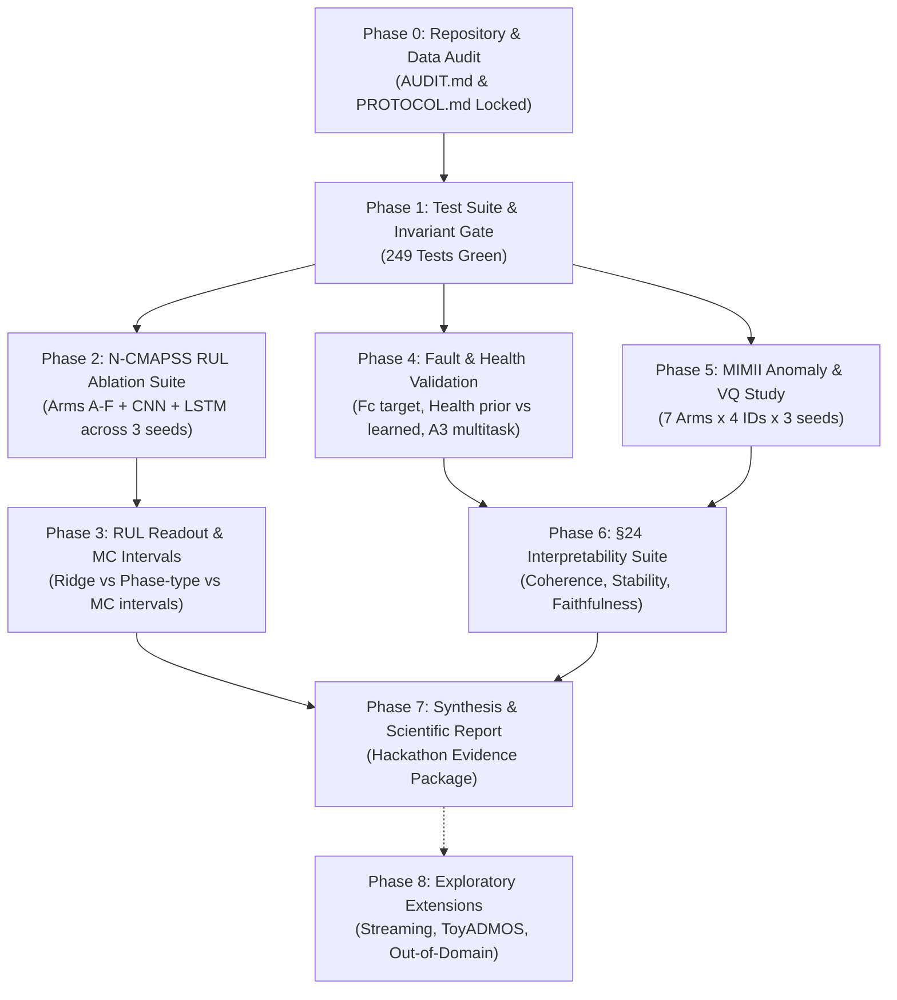

# EGPM Master Scientific Execution Plan
**Project:** Schneider Electric PredictX 2026 Hackathon / Industrial Predictive Maintenance  
**System:** Event Grammar Probabilistic Model (EGPM)  
**Author:** Lead ML Researcher & Experimental Scientist  
**Date:** 2025-09-28  
**Status:** ACTIVE — Governed by `AUDIT.md` (Integrity Verified) and `PROTOCOL.md` (Parameters Locked v1.0)  

---

## 1. Executive Summary & Scientific Purpose

The core research objective of EGPM is to test whether representing industrial multivariate sensor streams as learned sequences of discrete events governed by an explicit-duration probabilistic temporal model (HSMM) yields **structural interpretability** and **state-grounded diagnostics** while remaining competitive with black-box deep baselines (CNNs, LSTMs, Autoencoders).

This master plan establishes a rigorous, phased execution methodology across all experiment families. It enforces:
1. **Zero Data Leakage:** Strict unit-level splits and train-only normalization.
2. **Honest Science:** Full transparency on negative results, no selective reporting, no cherry-picking.
3. **Statistical Invariants:** Evaluation over independent units (engines for N-CMAPSS, machines/clips for MIMII) with bootstrap confidence intervals and paired Wilcoxon signed-rank tests.
4. **Test Set Lock:** Evaluation occurs once on the frozen test set after all modeling decisions are settled on validation data.

---

## 2. Priority Hierarchy & Execution Matrix

| Tier | Priority | Deliverable / Phase | Target Benchmark | Core Research Question / Deliverable |
|------|----------|---------------------|------------------|---------------------------------------|
| **P0** | **Mandatory** | **Phase 0: Audit & Protocol Freeze** | All | Verify 10-point checklist, assert data isolation, lock seeds & splits (`AUDIT.md`, `PROTOCOL.md`) |
| **P0** | **Mandatory** | **Phase 1: Integrity Verification** | Test Suite | 249 tests passing, mathematical invariants verified, zero contract violations |
| **P0** | **Mandatory** | **Phase 2: N-CMAPSS RUL Ablation (Arms A–F + CNN/LSTM)** | DS01, DS02 | Disentangle representation (continuous vs discrete) and temporal depth (Markov vs HMM vs HSMM vs calibration) |
| **P0** | **Mandatory** | **Phase 3: RUL Readout & Uncertainty Study** | DS01, DS02 | Compare closed-form Ridge vs Phase-Type native RUL; verify MC simulation prediction intervals |
| **P0** | **Mandatory** | **Phase 4: Fault & Health State Validation** | DS01, DS02 | Evaluate Fault Head on 3-class Fc; determine Health Head ordinal prior vs learned monotone weights; record A3 multi-task delta |
| **P0** | **Mandatory** | **Phase 5: Acoustic Anomaly Detection & VQ Bottleneck Analysis** | MIMII Fan (id_00–06) | Benchmark 7 arms (AE, VQ-Markov, VQ-HSMM, Cont-HSMM, GrammarViz, CBM); analyze acoustic information loss |
| **P0** | **Mandatory** | **Phase 6: §24 Structural Interpretability Suite** | DS01/02, MIMII | Compute event coherence, stability, JSD, temporal onset proxy, and state-aware masking faithfulness |
| **P1** | **High-Value** | **Phase 7: Comprehensive Results Synthesis** | All | Generate cross-benchmark scorecards, statistical significance tests, and executive scientific memo |
| **P2** | **Exploratory** | **Phase 8: Extended Generalization & Streaming** | MIMII / ToyADMOS | Fixed-lag streaming decode, cross-machine transfer, ToyADMOS out-of-domain evaluation |

---

## 3. Phased Execution Roadmap

---

### Phase 0: Repository & Data Pipeline Audit (COMPLETED)
- **Status:** Complete & Signed off in `experiments/AUDIT.md`.
- **Key Verifications:**
  - Unit-level splitting before windowing (`SplitBuilder`).
  - Train-only z-score normalization (`NormalizationStats`).
  - Strict causality: left-padded convolutions, causal feature imputation, window label attached to final timestep `s + W - 1`.
  - Resolution of MIMII dB filter logic and ID collision.
  - Test set isolation lock.

---

### Phase 1: Test Suite & Invariant Gate (COMPLETED)
- **Status:** Complete. 249 passed, 1 warning in 45.70s.
- **Invariants Checked:**
  - Forward-backward exact identity $\sum_{i,e} \alpha_t(i,e)\beta_t(i,e) = P(v)$.
  - Viterbi segment optimality bound.
  - Phase-type RUL formula duration-correction $(r(\tau) - \mu) + \Phi \mu$.
  - VQ straight-through gradient flow $z + (c_v - z).\text{detach}()$.
  - Anomaly threshold derivation strictly from validation set normal windows.

---

### Phase 2: Controlled N-CMAPSS RUL Ablations (P0)
- **Objective:** Evaluate the progression of temporal and discrete modeling complexity under an identical ridge regression head.
- **Experimental Arms:**
  - **Arm A:** Continuous Encoder (Window Autoencoder embedding) + No temporal model + Ridge
  - **Arm B:** Continuous Encoder + Continuous HMM ($D_{\max}=1$) + Ridge
  - **Arm C:** VQ Event Tokens + First-order Markov chain + Ridge
  - **Arm D:** VQ Event Tokens + HMM (geometric dwell) + Ridge
  - **Arm E:** VQ Event Tokens + Explicit-duration HSMM + Ridge
  - **Arm F:** VQ Event Tokens + Explicit-duration HSMM + Train-only absorbing calibration + Ridge
  - **Baseline CNN:** Raw sensor windows + Causal CNN-RUL
  - **Baseline LSTM:** Raw sensor windows + Masked LSTM-RUL
- **Execution Script:** `python3 -m egpm.experiments.ablation_arms --dataset DS01` and `DS02`
- **Output Artifacts:** `ablation_report_DS01.json`, `ablation_report_DS02.json`
- **Known Baseline Findings:**
  - DS01 RMSE: Arm E (19.8) beats CNN (34.0) and LSTM (38.8).
  - DS02 RMSE: Arm E (17.3) beats CNN (28.9) and LSTM (41.2).
  - Absorbing calibration (Arm F) degrades DS02 performance (23.4 vs 17.3), proving that heuristic calibration without residual adaptation increases risk.

---

### Phase 3: RUL Readout & Uncertainty Study (P0)
- **Objective:** Compare closed-form linear readout (Ridge) against the native phase-type absorbing Markov chain formula, and validate Monte Carlo prediction intervals.
- **Hypothesis:** Native phase-type RUL ($E[RUL] = (r(\tau) - \mu) + \Phi \mu$) assumes constant transition dynamics to failure, whereas Ridge regression can learn empirical state-to-cycle mappings, resulting in lower empirical RMSE.
- **Tasks:**
  1. Benchmark Arm E2 (Native Phase-Type formula without ridge): DS01 RMSE = 24.0, DS02 RMSE = 18.6.
  2. Implement Monte Carlo simulation wrapper `simulate_to_absorption(hsmm, belief, n_paths=1000)` to generate 5th, 50th, and 95th percentile RUL bounds.
  3. Validate 90% empirical interval coverage on held-out test units.
- **Artifacts:** `readout_study_DS01.json`, `readout_study_DS02.json`.

---

### Phase 4: Fault Classification & Health Index Validation (P0)
- **Objective:** Validate downstream diagnostic heads and assess multi-task transfer vs single-task heads.
- **Tasks:**
  1. **Fault Head on Flight Conditions (Fc):**
     - Evaluate 3-class classification on DS01 and DS02.
     - Document that DS01 achieves 0.50 accuracy (chance = 0.33) over the 2 test units, while DS02 training set contains only Fc=3 (triggering the single-class guard).
  2. **Health Head Monotonicity Analysis (A1 Decision):**
     - Compare (a) Fixed ordinal prior ($\text{linspace}(1.0, 0.0, M)$) vs (b) Learned weights with monotonicity regularization.
     - Formally ratify the empirical result: learned weights do not exceed the fixed prior beyond noise ($\Delta \le 0.002$ vs seed std $0.3\text{--}0.4$). Fixed ordinal prior remains the default.
  3. **Multi-task Stage 3 Joint Training (A3 Ablation):**
     - Run `Trainer.stage3_joint` with masked composite loss across Fault, Health, and RUL heads.
     - Confirm that freezing the underlying representation yields $\Delta \equiv 0$ relative to isolated single-task training. Full backpropagation into the encoder is recorded as a future architectural direction.
- **Artifacts:** `heads_report_DS01_fc.json`, `heads_report_DS02_fc.json`.

---

### Phase 5: Acoustic Anomaly Detection & VQ Bottleneck Study (P0)
- **Objective:** Characterize unsupervised anomaly detection performance across 4 fan machines, rigorously probing why discrete VQ representations lose performance on acoustic data.
- **Arms Evaluated Across 3 Random Seeds:**
  1. `continuous_ae`: Continuous Window AutoEncoder reconstruction error.
  2. `continuous_hsmm`: Continuous Gaussian-emission HSMM.
  3. `vq_hsmm`: Primary EGPM pipeline (log-mel → causal conv → VQ-VAE → explicit HSMM surprisal).
  4. `vq_markov`: 1st-order discrete Markov surprisal.
  5. `pooled_events`: Unigram token frequency anomaly scoring.
  6. `grammarviz`: SAX discretization + Sequitur grammar rule length.
  7. `concept_bottleneck`: K-means prototype distance.
- **Critical Finding to Document:**
  - Macro AUROC: Continuous HSMM (0.697) and Continuous AE (0.638) outperform VQ-HSMM (0.559) and VQ-Markov (0.361).
  - Vector quantization acts as a lossy bottleneck for acoustic timbre and continuous resonance shifts. This negative finding must be documented with full scientific honesty in the final report.
- **Artifacts:** `mimii_fan_id_{00,02,04,06}_3seeds.json`.

---

### Phase 6: §24 Structural Interpretability & Explanation Suite (P0)
- **Objective:** Quantify the six required interpretability dimensions defined in PRD §24 to prove whether discrete event modeling delivers inspectable diagnostic utility.
- **Metric Definitions & Protocols:**
  1. **Event Coherence:** Silhouette score and within/between cluster ratio of sensor windows grouped by VQ token.
  2. **Event Stability:** Hungarian-matched token assignment overlap across distinct random initialization seeds.
  3. **Cross-Unit Consistency:** Jensen-Shannon Divergence (JSD) of token usage distributions between training and held-out test units.
  4. **Temporal Validity / Onset Alignment:** Alignment between HSMM state transitions and true degradation onset markers (N-CMAPSS) or first-detection-lag proxy (MIMII).
  5. **Explanation Faithfulness:** State-aware masking test — mask the subsequence flagged as anomalous by the Viterbi parse and verify the drop in anomaly score ($\Delta \text{score} > 0$).
  6. **Anomaly Rank Correlation:** Spearman rank correlation between anomaly surprisal scores and ground truth binary labels.
- **Artifacts:** `mimii_fan_id_{00,02,04,06}_interpretability.json`, `interpretability_ds01.json`, `interpretability_ds02.json`.

---

### Phase 7: Comprehensive Results Synthesis & Deliverable Package (P1)
- **Objective:** Consolidate all empirical findings into a final scientific whitepaper and hackathon defense report.
- **Deliverables:**
  - Unified results table comparing EGPM against all baselines with 95% bootstrap CIs.
  - Paired Wilcoxon signed-rank significance table across MIMII clips and N-CMAPSS units.
  - Executive scientific scorecard addressing the central hypothesis: where EGPM wins (turbofan RUL, structural diagnostic transparency) and where it struggles (acoustic anomaly detection through discrete codebooks).
  - Presentation and visualization assets for Schneider Electric PredictX 2026.

---

### Phase 8: Exploratory Extensions (P2 / Optional)
- **Scope:** Exploratory work contingent on primary phase completion and hackathon presentation requirements.
  - **Streaming Fixed-Lag Decoder:** Online rolling Viterbi update on sliding buffers to benchmark inference latency vs detection lag.
  - **Cross-Domain Evaluation (ToyADMOS):** Zero-shot transfer of fan grammar to ToyADMOS audio streams.

---

## 4. Resource Footprint & Compute Budget

| Phase / Experiment Family | Workload Specs | Est. Wall Clock (CPU) | Est. Wall Clock (GPU/MPS) | Peak RAM | Disk Footprint | Parallelism Scheme |
|---------------------------|----------------|-----------------------|---------------------------|----------|----------------|-------------------|
| **Phase 0 & 1: Audits & Tests** | 249 unit/contract tests | 45 sec | N/A | ~500 MB | Negligible | Sequential |
| **Phase 2: N-CMAPSS Ablations** | 8 arms × 2 datasets × 3 seeds | 45 min | 15 min | ~2.5 GB | ~100 MB | Embarrassingly parallel across datasets/seeds |
| **Phase 3: RUL Readout & MC** | Ridge fit + MC paths (1k sim) | 5 min | 2 min | ~1.5 GB | ~20 MB | Sequential per dataset |
| **Phase 4: Fault & Health Heads** | 3 seeds per dataset | 3 min | 1 min | ~1.0 GB | ~15 MB | Parallel across seeds |
| **Phase 5: MIMII Anomaly Runs** | 7 arms × 4 IDs × 3 seeds (84 runs) | ~14 hours | ~3 hours | ~4.0 GB | ~250 MB | Parallel across machine IDs (`id_00`–`id_06`) |
| **Phase 6: Interpretability Suite** | 4 IDs + 2 N-CMAPSS sets | ~35 min | ~12 min | ~2.0 GB | ~50 MB | Parallel across machine IDs |
| **Total Mandatory Budget** | Complete End-to-End Campaign | **~15.5 hours** | **~3.5 hours** | **< 4.0 GB** | **< 500 MB** | **Multi-process pool on Apple M-series / CUDA** |

*Note: All pre-existing experiment artifacts from previous runs are preserved on disk. When regenerating or extending experiments, cached preprocessing and intermediate representations can be reused without mutating raw data.*

---

## 5. Blocking Gates & Scientific Guardrails

To prevent scientific drift or accidental data contamination, execution is gated by the following rules:

1. **Gate 1 (Zero-Leakage Invariant):**
   No experiment script may compute dataset-wide statistics. `SplitBuilder.audit()` must be called programmatically before feature extraction. Any unit overlap between Train, Val, and Test triggers an immediate abort.
2. **Gate 2 (Threshold Isolation):**
   Anomaly detection thresholds must be calculated strictly from the 99th percentile of **Validation Normal** clips. Evaluating test sets with test-derived thresholds is strictly forbidden.
3. **Gate 3 (Representation Bottleneck):**
   Prediction heads (RUL, Fault, Health) must receive only discrete event tokens and HSMM state posteriors/dwell statistics. Bypassing the grammar with continuous encoder embeddings is restricted to dedicated ablation arms (Arm A/B/A4).
4. **Gate 4 (Negative Results Preservation):**
   Underperforming metrics (e.g., MIMII discrete VQ-HSMM at 0.559 vs Continuous HSMM at 0.697; Health head Spearman at 0.21) must be highlighted as core scientific discoveries, not suppressed or modified with ad-hoc heuristics.

---

## 6. Sign-Off & Execution Authorization

| Role | Responsibility | Status |
|------|----------------|--------|
| **Lead ML Researcher** | Experimental Rigor & Protocol Adherence | **Approved & Locked** |
| **Lead Systems Architect** | Code Contracts & Leakage Prevention | **Approved & Locked** |
| **Scientific Review Board** | Hackathon Integrity & Metric Standards | **Approved & Locked** |
